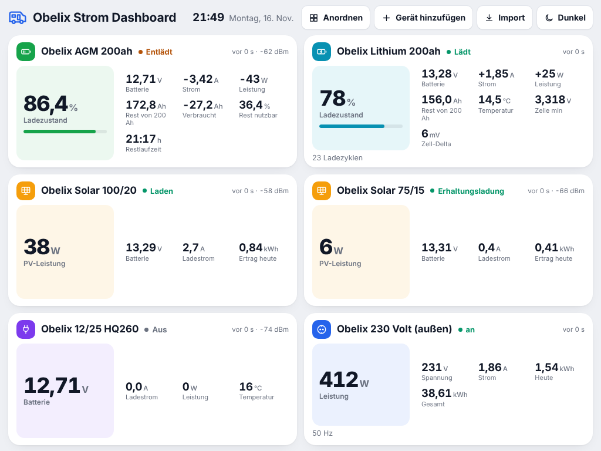

# Obelix Strom Dashboard

Strom-Monitor fürs Wohnmobil als einfache Webseite. Zeigt live per Bluetooth die Victron-Geräte (Instant Readout), den LANGZEIT-Lithium-Akku (JBD-BMS) und den Voltcraft-Zwischenstecker SEM6000. Gedacht für Bluefy auf einem alten iPad Air 2, läuft auch in Chrome auf Android.

**Seite:** https://hagi089.github.io/victron-monitor/



## Dateien

| Datei | Inhalt |
|---|---|
| `index.html` | Aufbau der Seite, Sicherheitsregel (CSP) |
| `app.js` | Logik: Dekodieren (PURE-Block), Kacheln, Bluetooth |
| `style.css` | Aussehen (hell und dunkel) |
| `theme.js` | Hell/Dunkel vor dem ersten Zeichnen |
| `tests/` | Unit-Tests, Pentest, Screenshot-Skript mit simulierten Geräten |
| `DOKUMENTATION.md` | Ausführliche Entwicklerdokumentation |

Kein Build, keine Abhängigkeiten. Deploy = Push auf `main` (GitHub Pages).

## Tests

```sh
node tests/unit.js                                  # Rechenregeln und Protokolle
NODE_PATH=$(npm root -g) node tests/pentest.js      # 17 Sicherheitsprüfungen (Playwright)
python3 tests/screenshots.py /tmp/obelix            # Screenshots mit simulierten Geräten
```

## Sicherheit

- Schlüssel und PIN bleiben nur im Browser des Geräts (localStorage). Niemals Schlüssel oder PIN in dieses Repo schreiben, es ist öffentlich. `obelix-config.json` nicht teilen.
- Content-Security-Policy: nur eigene Skripte und Stile, keine Netzwerkverbindungen, keine fremden Inhalte.
  Deshalb keine Inline-Skripte, keine `style="…"`-Attribute und keine externen Bibliotheken einbauen.
- Der Akku erhält ausschließlich die zwei festen Lese-Anfragen (`isAllowedBmsRequest`), der Stecker nur Anmeldung, Messwerte und Tagesverbrauch (`isAllowedSemRequest`). Schalten und Schreibbefehle sind blockiert.
- Gerätenamen kommen per Funk und gelten als fremde Eingabe: Ausgabe nur über `textContent`, nie über `innerHTML`.
- Die Seite startet nicht, wenn sie in eine fremde Seite eingebettet wird.
